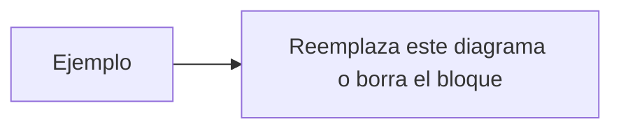

<!--
  Título: [TYPE] Título breve
  Tipos: [FEATURE] [FIX] [HOTFIX] [CHORE] [REFACTOR] [DOCS] [TEST] [PERF] [BUILD] [RELEASE]
  Base: develop (releases y hotfixes hacia master)
-->

# Task

- **Issue:** https://github.com/Yeyo-Systems/yeyo-systems-web/issues/N
  `Closes #N`

# Descripción

- ¿Qué problema o alcance cubre este PR?
- ¿Cómo lo resolviste (enfoque técnico breve)?

# Evidencias

## Visual

<!-- Si NO hay cambios visuales, escribe "N/A". Incluye tema claro y oscuro, móvil y escritorio. -->

| Antes | Después |
|-------|---------|
| <!-- captura o N/A --> | <!-- captura o N/A --> |

## No visual (arquitectura, flujos, infra, dominio)

## Criterios de aceptación

- [ ] Copiados desde la issue; marca lo cubierto por este PR.

## Pruebas ejecutadas

- `npm run lint`:
- `npm run typecheck`:
- `npm run build`:
- Manual (URL de develop / local):

## Checklist de calidad

- [ ] Sin imports de Next.js, React o Firebase en `src/domain/`.
- [ ] Componentes solo consumen hooks de `src/presentation/hooks/`.
- [ ] Sin secretos ni configuración Firebase en archivos versionados.
- [ ] Colores dentro de la paleta corporativa; dark mode con `dark:`.
- [ ] Errores async manejados (try/catch o `.catch()`).
- [ ] Documentación actualizada si cambia el flujo o la arquitectura.
- [ ] Cuerpo incluye `Closes #N`.
